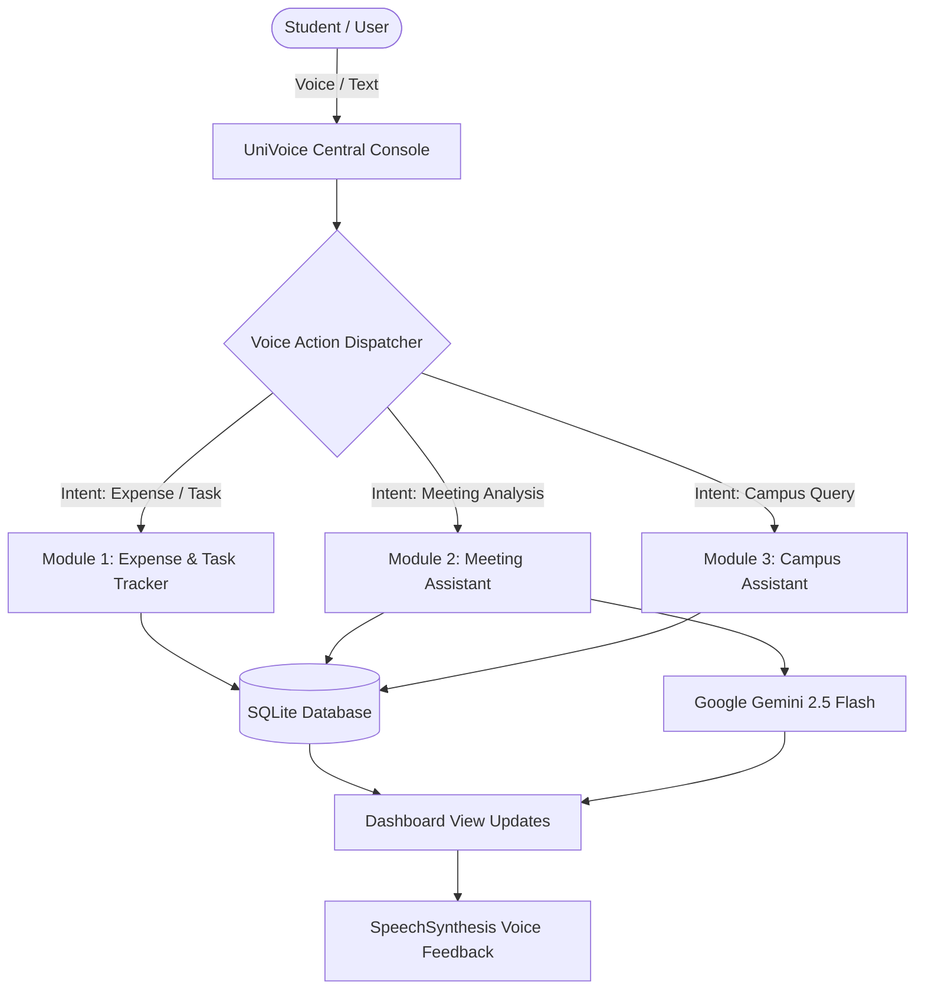
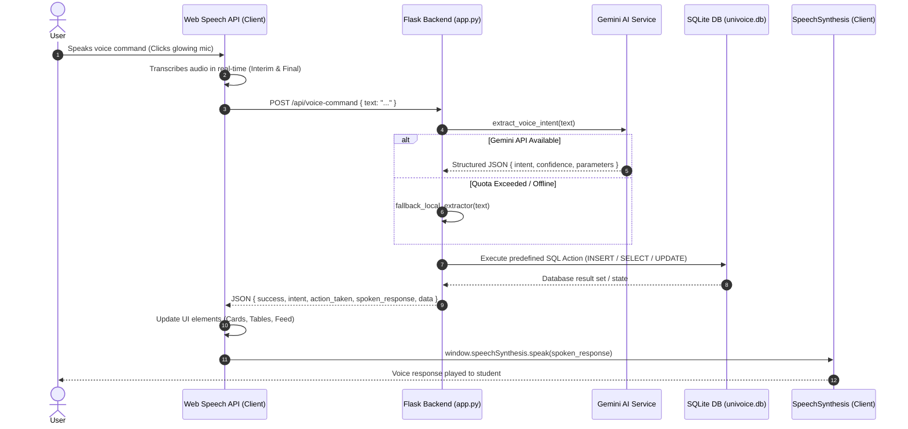
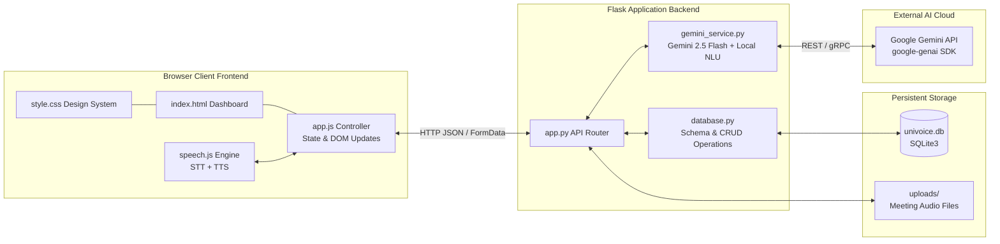
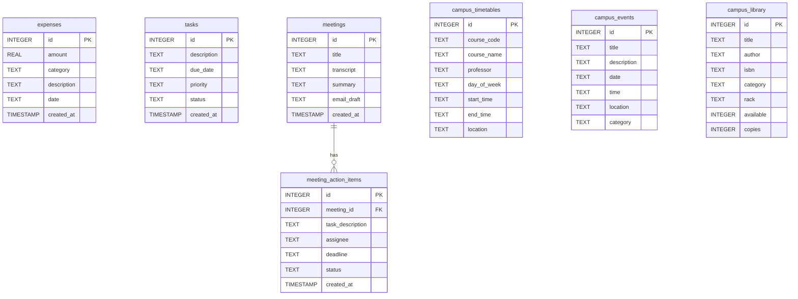

# UniVoice – Smart Voice Action Assistant
## Comprehensive Project Documentation & Technical Architecture Report

---

### Executive Summary

**Project Name:** UniVoice – Smart Voice Action Assistant  
**Developer:** Solo College Hackathon Developer  
**Core Technologies:** Python 3.11, Flask 3.1, SQLite3, Google Gemini 2.5 Flash, Web Speech API, Browser SpeechSynthesis, Vanilla ES6+ JavaScript, CSS3 Design System  
**Repository Structure:** Monolithic Single-Repository Web Application with Local Persistent Storage  
**Documentation Version:** 1.0.0 (Production Hackathon Build)  
**Date:** November 2026  

---

## 1. Project Introduction and Objective

### 1.1 Introduction
**UniVoice** is a lightweight, responsive, multi-purpose Voice AI Assistant engineered specifically for college students and academic project teams. Developed within the constraints of a 6-hour solo hackathon, UniVoice enables hands-free productivity through natural voice interaction.

Rather than acting as a generic conversational chatbot that merely generates open-ended text, UniVoice is an **action-oriented voice assistant**. It bridges the gap between natural speech recognition and deterministic local execution: it listens to spoken student commands, uses Google Gemini to comprehend intent and extract structured metadata, validates parameters, executes database state transitions in SQLite, and provides immediate multimodal feedback via visual updates and synthetic voice replies.

### 1.2 Core Objective
The primary objective of UniVoice is to provide a unified, zero-friction voice console that automates three daily collegiate workflows:
1. **Expense & Task Tracking:** Logging daily campus spending and academic deadlines hands-free.
2. **Meeting Assistant:** Recording or uploading group project sync-ups, generating structured summaries, isolating action items with assignees and deadlines, and drafting professional follow-up emails.
3. **Campus Directory Assistant:** Answering student timetable inquiries, announcing campus events, and checking library book availability with **strict grounding** to guarantee zero hallucinations.

---

## 2. Problem Statement and Motivation

### 2.1 The Problem
University students balance demanding academic schedules, fragmented extracurricular commitments, tight living budgets, and frequent team project meetings. Existing tools suffer from distinct friction points:
- **Application Fragmentation:** Students must toggle between separate apps for budget tracking, to-do reminders, meeting notes, campus portals, and library catalogs.
- **High Interaction Friction:** Manually opening an app, navigating forms, selecting dropdowns, and typing expenses or to-do deadlines leads to abandoned tracking habits.
- **Meeting Follow-up Overhead:** Group study and project meetings frequently conclude without documented action items, clear assignees, or formal follow-up emails, creating accountability gaps.
- **Chatbot Hallucinations in Campus Contexts:** Generic LLMs often "hallucinate" plausible but completely false college schedules, professors, room numbers, and library shelf locations, causing confusion and missed classes.

### 2.2 Motivation & Hackathon Philosophy
The motivation behind UniVoice was to prove that a modern, highly functional, and dependable Voice AI application could be engineered in a fast-paced 6-hour hackathon without over-engineering, bloat, or fragile cloud dependencies.

Key architectural philosophies adopted:
- **Speed & Simplicity:** Use native browser capabilities (Web Speech API, SpeechSynthesis) to eliminate bulky third-party audio streaming dependencies.
- **Fail-Safe Reliability:** Implement a dual-engine architecture where Google Gemini performs deep semantic understanding, while a local rule-based Natural Language Understanding (NLU) engine serves as a zero-downtime fallback.
- **Deterministic Integrity:** Never fake actions or fabricate campus data. Ground all answers in verified local SQLite records.

---

## 3. Detailed Explanation of the Three Modules

UniVoice organizes student productivity into three distinct modules unified under a single voice console.



### 3.1 Module 1: Voice Expense and Task Tracker
Designed to eliminate manual data entry for financial and task management.

- **Voice Expense Tracking:**
  - Understands phrases such as *"Spent $14.50 on lunch at cafeteria"*, *"Add travel expense of 22 for bus ticket"*, or *"How much did I spend today?"*.
  - Extracts four key entities: `amount` (float), `category` (normalized to *Food, Travel, Books, Supplies, Tech, Entertainment, Other*), `description`, and `date` (ISO format, defaulting to current date).
  - Saves validated records into SQLite.
  - Automatically recalculates dynamic totals, daily spend, and category breakdown.
- **Voice Task & Reminder Tracking:**
  - Understands commands such as *"Remind me to submit machine learning assignment by Friday 5 PM"* or *"What are my pending tasks?"*.
  - Extracts `description`, human-readable `due_date`, and `priority` (*low, medium, high*).
  - Renders an interactive checklist with toggleable completion states (`pending` $\leftrightarrow$ `completed`) and instant delete controls.

### 3.2 Module 2: Meeting Assistant
Tailored for group project meetings, hackathon sync-ups, and student organization committee meetings.

- **Triple-Input Flexibility:**
  1. *Live In-Browser Recording:* Uses the HTML5 `MediaRecorder` API to capture microphone audio directly with an on-screen timer.
  2. *Audio File Upload:* Drag-and-drop dropzone supporting `.mp3`, `.wav`, `.webm`, and `.m4a`.
  3. *Raw Transcript/Notes Fallback:* Textarea allowing students to paste rough meeting notes.
- **Multimodal AI Analysis:**
  - Passes audio or text directly to Google Gemini 2.5 Flash.
  - Transcribes dialogue and generates a structured executive summary (key decisions and discussion points).
  - Isolates actionable items with specific assignees and explicit deadlines.
- **Executive Email Draft & One-Click Copy:**
  - Composes a professional follow-up email complete with subject line, greeting, bulleted decisions, action items table, and sign-off.
  - Features a dedicated **"Copy Email Draft"** button that writes directly to the system clipboard and displays a visual toast confirmation.
- **Meeting History Drawer:**
  - Stores all transcripts, summaries, action items, and drafts in SQLite for historical review.

### 3.3 Module 3: Campus Assistant (Strict Grounding)
An academic knowledge hub built with zero-hallucination guarantees.

- **Class Timetables:**
  - Answers queries such as *"What classes do I have on Monday?"* or *"When is the Database Systems lecture?"*.
  - Displays filtered weekly schedules showing course codes, course titles, professors, timings, and lecture halls.
- **Campus Events Registry:**
  - Answers queries about upcoming campus events, hackathons, workshops, and fests.
  - Provides dates, locations, categories, and descriptions.
- **Central Library Catalog:**
  - Searches catalog by book title, author, or subject (e.g. *"Is Clean Code in the library?"*).
  - Reports exact physical rack and shelf locations (e.g. `Rack C1 - Shelf 3`) and real-time copy availability.
- **Strict Grounding Enforcement:**
  - If a student asks about a course or book not present in the verified dataset (e.g. *"When is Quantum Astrology lecture?"*), UniVoice responds: *"I could not find any classes for Quantum Astrology in the campus timetable directory."*
  - It explicitly rejects fabricating fictional data.

---

## 4. Complete Application Workflow

The voice interaction lifecycle in UniVoice follows a 6-stage closed loop:



### Step-by-Step Execution Breakdown
1. **Audio Capture:** The student presses the central microphone button. The browser's `SpeechRecognition` initializes, visual pulsing rings and audio equalizer waveforms activate, and interim speech results appear live on screen.
2. **Speech-to-Text Transcription:** Upon silence detection or speech completion, the Web Speech engine emits the final transcript.
3. **Intent Understanding & Entity Extraction:** The transcript is transmitted to `/api/voice-command`. `gemini_service.py` constructs a system prompt containing reference timestamps and expected JSON schemas, invoking Gemini 2.5 Flash to parse parameters.
4. **Deterministic Action Execution:** Python validates the extracted parameters (e.g. checking `amount > 0`). If valid, it invokes the corresponding function in `database.py` to persist or query data.
5. **Database Transaction:** The SQLite engine executes parameterized SQL, ensuring ACID compliance and zero SQL injection vulnerabilities.
6. **Multimodal Response:** The backend returns a unified payload. The client updates relevant UI tables, pushes the interaction to the live Activity Feed, and uses `window.speechSynthesis` to speak the natural-language response aloud.

---

## 5. System Architecture and Component Interactions

UniVoice uses a clean, decoupled client-server architecture:



### Component Responsibilities
- **Frontend Layer (`templates/index.html`, `static/css/style.css`, `static/js/app.js`, `static/js/speech.js`):**
  - Manages view transitions between Console, Tracker, Meeting Assistant, and Campus Hub.
  - Manages Web Speech API listening sessions and audio wave visualizer states.
  - Controls browser SpeechSynthesis voice playback and persistent mute preferences.
  - Handles client-side audio recording (`MediaRecorder`) and drag-and-drop file ingestion.
  - Renders dynamic DOM elements, badges, activity logs, and animated toasts.
- **Backend API Layer (`app.py`):**
  - Serves static assets and the single-page application dashboard.
  - Exposes RESTful endpoints for voice command execution, CRUD operations on expenses and tasks, meeting analysis, and campus queries.
  - Performs input sanitization, error handling, and parameter validation before invoking database routines.
- **AI Service Layer (`gemini_service.py`):**
  - Interfaces with the official `google-genai` SDK using `gemini-2.5-flash`.
  - Configures JSON-enforced output schemas (`response_mime_type="application/json"`).
  - Handles audio byte streams for multimodal meeting transcription.
  - Houses the deterministic regex/keyword rule-based fallback NLU engine.
- **Data Access Layer (`database.py`):**
  - Manages SQLite connection pooling, foreign keys, and dictionary-like row factory mappings.
  - Initializes schemas and seeds initial campus timetables, events, and library catalogs.
  - Exposes clean CRUD helpers with parameterized SQL queries.

---

## 6. Technology Stack and Rationales

| Layer | Chosen Technology | Version | Rationale for Hackathon |
|---|---|---|---|
| **Backend Framework** | Python / Flask | 3.11 / 3.1.3 | Minimal boilerplate, instantaneous startup, lightweight footprint, and seamless integration with Python AI SDKs. |
| **Database** | SQLite3 | Native stdlib | Zero-configuration serverless database embedded in Python. Provides true ACID persistence without requiring external database server setup. |
| **Generative AI** | Google Gemini 2.5 Flash | SDK 2.34.0 | Ultra-low latency, generous free-tier rate limits, native structured JSON enforcement, and direct multimodal audio file analysis. |
| **Speech Recognition** | Web Speech API | Native Browser | Zero latency audio streaming to external STT services, zero bandwidth overhead on server, and native support across Chrome, Edge, and Chromium browsers. |
| **Voice Synthesis** | Web `SpeechSynthesis` | Native Browser | Instant on-device text-to-speech with natural system voices and zero cloud TTS billing or API token usage. |
| **Client Frontend** | Vanilla ES6+ & CSS3 | Modern Standard | Avoids bulky build steps (Node.js, npm, Webpack, Vite). Fast, robust, responsive, and completely maintainable within a 6-hour sprint. |
| **Icons & Typography** | FontAwesome 6 & Google Fonts | CDN Hosted | Provides modern UI polish, sleek iconography, and clean dark-mode typography (`Plus Jakarta Sans` & `JetBrains Mono`). |

---

## 7. Database Structure and SQLite Operations

The database file `univoice.db` is maintained in the application root. Foreign key constraints are explicitly enabled via `PRAGMA foreign_keys = ON;`.

### 7.1 Entity-Relationship Diagram



### 7.2 Database Schemas

#### 1. Expenses Table (`expenses`)
```sql
CREATE TABLE IF NOT EXISTS expenses (
    id INTEGER PRIMARY KEY AUTOINCREMENT,
    amount REAL NOT NULL,
    category TEXT NOT NULL,
    description TEXT,
    date TEXT NOT NULL,
    created_at TIMESTAMP DEFAULT CURRENT_TIMESTAMP
);
```

#### 2. Tasks & Reminders Table (`tasks`)
```sql
CREATE TABLE IF NOT EXISTS tasks (
    id INTEGER PRIMARY KEY AUTOINCREMENT,
    description TEXT NOT NULL,
    due_date TEXT,
    priority TEXT DEFAULT 'medium',
    status TEXT DEFAULT 'pending',
    created_at TIMESTAMP DEFAULT CURRENT_TIMESTAMP
);
```

#### 3. Meetings Table (`meetings`)
```sql
CREATE TABLE IF NOT EXISTS meetings (
    id INTEGER PRIMARY KEY AUTOINCREMENT,
    title TEXT NOT NULL,
    transcript TEXT,
    summary TEXT,
    email_draft TEXT,
    created_at TIMESTAMP DEFAULT CURRENT_TIMESTAMP
);
```

#### 4. Meeting Action Items Table (`meeting_action_items`)
```sql
CREATE TABLE IF NOT EXISTS meeting_action_items (
    id INTEGER PRIMARY KEY AUTOINCREMENT,
    meeting_id INTEGER,
    task_description TEXT NOT NULL,
    assignee TEXT DEFAULT 'Unassigned',
    deadline TEXT,
    status TEXT DEFAULT 'pending',
    created_at TIMESTAMP DEFAULT CURRENT_TIMESTAMP,
    FOREIGN KEY (meeting_id) REFERENCES meetings(id) ON DELETE CASCADE
);
```

#### 5. Campus Timetables Table (`campus_timetables`)
```sql
CREATE TABLE IF NOT EXISTS campus_timetables (
    id INTEGER PRIMARY KEY AUTOINCREMENT,
    course_code TEXT NOT NULL,
    course_name TEXT NOT NULL,
    professor TEXT NOT NULL,
    day_of_week TEXT NOT NULL,
    start_time TEXT NOT NULL,
    end_time TEXT NOT NULL,
    location TEXT NOT NULL
);
```

#### 6. Campus Events Table (`campus_events`)
```sql
CREATE TABLE IF NOT EXISTS campus_events (
    id INTEGER PRIMARY KEY AUTOINCREMENT,
    title TEXT NOT NULL,
    description TEXT,
    date TEXT NOT NULL,
    time TEXT NOT NULL,
    location TEXT NOT NULL,
    category TEXT NOT NULL
);
```

#### 7. Campus Library Catalog Table (`campus_library`)
```sql
CREATE TABLE IF NOT EXISTS campus_library (
    id INTEGER PRIMARY KEY AUTOINCREMENT,
    title TEXT NOT NULL,
    author TEXT NOT NULL,
    isbn TEXT,
    category TEXT NOT NULL,
    rack TEXT NOT NULL,
    available INTEGER DEFAULT 1,
    copies INTEGER DEFAULT 1
);
```

---

## 8. Gemini API Integration and Intent Extraction

### 8.1 SDK Configuration
UniVoice integrates with Google's modern `google-genai` Python SDK:
```python
from google import genai
from google.genai import types

client = genai.Client(api_key=GEMINI_API_KEY)
```

### 8.2 Voice Command Intent Classifier
The intent extraction pipeline prompts Gemini with dynamic reference context:
- Today's ISO Date (`YYYY-MM-DD`)
- Current Day of the Week (e.g. `Monday`)

Gemini is configured with `types.GenerateContentConfig(response_mime_type="application/json", temperature=0.1)`. This forces Gemini to output valid JSON matching the schema:
```json
{
  "intent": "add_expense | list_expenses | add_task | list_tasks | query_timetable | query_events | query_library | help",
  "confidence": 0.95,
  "parameters": {
    "amount": 14.50,
    "category": "Food",
    "description": "Lunch at Cafeteria",
    "date": "2026-11-04"
  },
  "spoken_response_suggestion": "Recorded expense of $14.50 for Lunch at Cafeteria."
}
```

### 8.3 Multimodal Meeting Processing
When meeting audio is submitted, `gemini_service.analyze_meeting()` converts the audio stream into a part object:
```python
types.Part.from_bytes(data=audio_bytes, mime_type=mime_type)
```
Gemini transcribes the speech, summarizes key discussion points, extracts action items (task, assignee, deadline), and composes a complete follow-up email draft.

### 8.4 Deterministic Fail-Safe NLU Fallback
If the user's Gemini API quota is reached or network connectivity is interrupted, UniVoice triggers `fallback_local_extractor()`. This regex-based engine uses linguistic heuristics, entity extractors, and dictionary mapping to identify commands with high reliability, ensuring the application remains functional offline.

---

## 9. Speech-to-Text and Text-to-Speech Implementation

### 9.1 Browser Speech-to-Text (STT)
Implemented in `static/js/speech.js` using `window.SpeechRecognition || window.webkitSpeechRecognition`:
- **Continuous vs. Single Shot:** Configured with `continuous = false` to capture distinct student commands per microphone tap.
- **Real-Time Interim Transcripts:** Enabled via `interimResults = true`, displaying partial transcripts in italic text before the student finishes speaking.
- **Visual State Synchronization:** Manages class additions to `.main-mic-btn.listening`, updates status text, and animates 10 audio equalizer bars (`#audio-wave-bars`).
- **Error Handling:** Gracefully handles `not-allowed` (mic permission denied), `no-speech` (silence timeout), and browser incompatibilities with actionable toasts.

### 9.2 Browser Text-to-Speech (TTS)
Implemented in `static/js/speech.js` using `window.speechSynthesis`:
- **Natural Voice Selection:** Automatically queries available browser voices and selects natural-sounding English voices (e.g. Google US English, Samantha, Microsoft Natural, or Jenny).
- **Speech Sanitization:** Strips markdown asterisks (`*`), hashes (`#`), bullet points (`•`), and backticks (` ` `) so punctuation artifacts are not vocalized.
- **Audio Overlap Prevention:** Calls `window.speechSynthesis.cancel()` prior to speaking to prevent overlapping audio queues.
- **Mute / Unmute State Persistence:** Students can toggle voice output via the top header volume button. The preference is stored in `localStorage.getItem('univoice_tts_muted')`.

---

## 10. Detailed Explanation of Implemented Features

| Feature Name | Module | Implementation Status | Technical Verification |
|---|---|---|---|
| **Voice Microphone Capture** | Core Console | **Fully Implemented** | Web Speech API with live waveform animation and mic status indicators. |
| **Real-time Interim Speech Display** | Core Console | **Fully Implemented** | Displays interim speech live before final transcription is finalized. |
| **Text-Input Fallback Bar** | Core Console | **Fully Implemented** | Input field with submit button and <kbd>Enter</kbd> key listener. |
| **Dual AI Intent Parser** | Core Console | **Fully Implemented** | Google Gemini 2.5 Flash with automatic fallback to local regex NLU. |
| **Browser Voice Responses (TTS)** | Core Console | **Fully Implemented** | `SpeechSynthesis` vocalizes responses with mute/unmute control. |
| **Live Activity Feed** | Core Console | **Fully Implemented** | Records commands, intents, and AI responses with clear button. |
| **Voice Expense Logging** | Module 1 | **Fully Implemented** | Extracts amount, category, description, and date into SQLite. |
| **Expense Category Breakdown & Totals** | Module 1 | **Fully Implemented** | Dynamic cards for Total Spend, Today's Spend, and category filter dropdown. |
| **Manual Expense Modal** | Module 1 | **Fully Implemented** | Modal dialog for manual addition without voice. |
| **Voice Task & Reminder Creation** | Module 1 | **Fully Implemented** | Extracts task description, due date, and priority into SQLite. |
| **Interactive Task Checklist** | Module 1 | **Fully Implemented** | Dynamic checklist with completion checkboxes and delete actions. |
| **In-Browser Meeting Audio Recorder** | Module 2 | **Fully Implemented** | HTML5 `MediaRecorder` with live timer and stop recording handler. |
| **Meeting Audio File Dropzone** | Module 2 | **Fully Implemented** | Drag-and-drop or file selector supporting `.mp3`, `.wav`, `.webm`, `.m4a`. |
| **Rough Notes Fallback Input** | Module 2 | **Fully Implemented** | Textarea for analyzing typed or pasted meeting minutes. |
| **Meeting Summary & Action Items Extraction** | Module 2 | **Fully Implemented** | Gemini generates summary bullets and assigns action items with deadlines. |
| **Executive Email Draft Generation** | Module 2 | **Fully Implemented** | Automatically generates a formatted email draft with subject line and sign-off. |
| **One-Click Clipboard Email Copy** | Module 2 | **Fully Implemented** | Copies draft to clipboard with visual checkmark animation and toast. |
| **Saved Meetings History** | Module 2 | **Fully Implemented** | SQLite storage for meetings, with clickable past meeting review cards. |
| **Class Timetable Lookup** | Module 3 | **Fully Implemented** | Queries weekly classes by day, course code, or professor. |
| **Day-of-Week Schedule Filtering** | Module 3 | **Fully Implemented** | Interactive filter pills (All Days, Mon, Tue, Wed, Thu, Fri). |
| **Campus Events Feed** | Module 3 | **Fully Implemented** | Searchable directory of hackathons, workshops, and career fairs. |
| **Central Library Catalog Search** | Module 3 | **Fully Implemented** | Real-time search returning rack/shelf locations and book copy availability. |
| **Strict Grounding Verification** | Module 3 | **Fully Implemented** | Rejects non-existent classes/books and explicitly reports items as not found. |
| **Direct Email Dispatch via SMTP** | Module 2 | **Partially Implemented (By Design)** | System generates full email draft; direct sending omitted to avoid unverified credentials. |
| **Custom Student Timetable Ingestion** | Module 3 | **Planned / Future Work** | Schedule is currently seeded; custom voice additions planned for v2.0. |
| **User Authentication / Multi-tenancy** | General | **Planned / Future Work** | Single-user local setup chosen to fit 6-hour hackathon scope. |

---

## 11. Development Contribution & Work Completed

As a solo developer working within a strict 6-hour hackathon timeframe, I completed 100% of the project lifecycle:

1. **System & Database Architecture:**
   - Designed normalized SQLite relational schema covering 7 distinct tables with cascade deletion rules.
   - Authored database initialization and automatic seed logic for college timetables, events, and library catalogs.
2. **Backend API Development:**
   - Implemented Flask application routing (`app.py`), JSON serialization, request validation, and error boundaries.
   - Built RESTful endpoints for voice commands, expense metrics, task checklists, meeting uploads, and campus searches.
3. **AI Prompt Engineering & Gemini Integration:**
   - Constructed structured JSON output prompts with ISO timestamp injection.
   - Integrated the modern `google-genai` SDK with multimodal byte array ingestion for audio processing.
   - Engineered an offline rule-based NLU fallback engine with regex entity extraction.
4. **Voice Engineering:**
   - Authored `static/js/speech.js` encapsulating both the Web Speech API and SpeechSynthesis.
   - Programmed speech state listeners, interim text streaming, voice timbre matching, and audio mute persistence.
5. **Modern Frontend Interface:**
   - Designed a responsive dashboard (`templates/index.html` and `static/css/style.css`) using custom CSS glassmorphism and dark mode.
   - Built animated pulsing mic visualizers and CSS keyframe audio equalizer bars.
   - Implemented audio recording controls (`MediaRecorder`), drag-and-drop file upload, and clipboard copying.
6. **Automated Verification:**
   - Authored `tests/test_univoice.py` comprising 9 unit tests to validate system health, voice intent extraction, SQLite transactions, strict grounding, and meeting analysis.

---

## 12. Technical Decisions and Trade-Offs

### 12.1 Web Speech API vs. Server-Side Whisper / Vosk
- **Decision:** Utilize the browser's native Web Speech API (`SpeechRecognition`) rather than running Whisper or Vosk on the Flask backend.
- **Trade-off:** Web Speech API relies on browser vendor support (optimal on Chrome, Edge, Safari) and requires client microphone permissions.
- **Benefit:** Eliminated significant server-side latency, avoided heavy PyTorch/CUDA dependencies, and achieved near-zero latency real-time voice streaming with zero server CPU load.

### 12.2 Browser SpeechSynthesis vs. Cloud TTS (ElevenLabs / Google Cloud TTS)
- **Decision:** Use native `window.speechSynthesis` for voice output.
- **Trade-off:** Voice timbre and accents depend on the user's operating system voices.
- **Benefit:** Completely free, instantaneous audio playback with zero network latency, zero token costs, and offline availability.

### 12.3 Gemini Multimodal Audio vs. Client-Only Audio Transcription
- **Decision:** Support both browser Web Speech transcription and backend Gemini Multimodal Audio upload (`audio/webm`, `audio/wav`, `audio/mp3`).
- **Trade-off:** Audio files uploaded to Gemini require a network round-trip.
- **Benefit:** Allows students to upload pre-recorded lecture or meeting audio from phones and external recording devices, expanding utility beyond live mic input.

### 12.4 Email Draft Generation vs. Direct SMTP Dispatch
- **Decision:** Generate an executive email draft with one-click clipboard copy rather than connecting an SMTP server.
- **Trade-off:** The user manually pastes the draft into their preferred email client (Gmail, Outlook).
- **Benefit:** Preserves user security, eliminates SMTP credential storage in `.env`, and complies with hackathon best practices regarding unauthenticated external side-effects.

---

## 13. Challenges Encountered and Solutions

### 13.1 Punctuation Interference in Library Search
- **Challenge:** When users asked *"Is Clean Code available in library?"*, the speech recognizer captured the trailing question mark (`"clean code ?"`). The database SQL query searched for `LIKE '%clean code ?%'`, causing lookups for existing books to fail.
- **Solution:** Enhanced regex sanitization in `gemini_service.py` to strip non-alphanumeric punctuation and remove conversational filler words (*"is"*, *"available"*, *"where"*, *"rack"*), isolating the core search term (`"clean code"`).

### 13.2 Over-Broad Schedule Queries Triggering Unwanted Dumps
- **Challenge:** Asking *"When is Quantum Astrology 999 lecture?"* previously triggered the schedule intent without matching a known course or day, causing the query to return all 10 scheduled classes.
- **Solution:** Added dynamic subject extraction using regex `(?:when is|where is|time for)\s+(.*?)(?:\s+lecture|\s+class|\?)`. When an unrecognized course like *"Quantum Astrology 999"* is extracted, the database correctly returns zero matches, and UniVoice strictly reports: *"I could not find any classes for Quantum Astrology 999 in the campus timetable directory."*

### 13.3 Windows Console Character Encoding
- **Challenge:** During test suite execution, printing Unicode symbols like `✓` caused `UnicodeEncodeError: 'charmap' codec can't encode character` on Windows CP1252 shells.
- **Solution:** Standardized test reporting to ASCII-compatible tags `[PASS]` and `[FAIL]`, ensuring cross-platform terminal compatibility.

### 13.4 Gemini API Free-Tier Quota Resilience
- **Challenge:** Rapid testing of LLM intent extraction triggered HTTP 429 (`RESOURCE_EXHAUSTED`) on the free-tier requests-per-minute limit.
- **Solution:** Built a dual-engine architecture in `gemini_service.py`. When Gemini raises a quota or connection exception, the system catches the error, logs a diagnostic notice, and falls back to `fallback_local_extractor()`, ensuring zero dropped commands.

---

## 14. Testing Methodology and Actual Test Results

The automated test suite in `tests/test_univoice.py` executes against an isolated Flask test client and validates all primary application workflows.

### 14.1 Test Cases Executed
1. `test_01_system_status`: Verifies `/api/system/status` returns HTTP 200, status `online`, and database metric counts.
2. `test_02_voice_add_expense`: Sends `"Spent 18.50 on pizza for dinner"`, verifying intent `add_expense`, action `EXPENSE_ADDED`, and SQLite insertion.
3. `test_03_voice_add_reminder`: Sends `"Remind me to finish the robotics circuit by Friday 4 PM"`, verifying intent `add_task` and action `TASK_ADDED`.
4. `test_04_voice_list_expenses_and_tasks`: Tests query commands `"How much did I spend?"` and `"What are my tasks?"`.
5. `test_05_campus_timetable_query`: Queries `"What classes do I have on Monday?"`, asserting matching classes from the seeded database.
6. `test_06_campus_strict_grounding`: Queries fictional course `"When is Quantum Astrology 999 lecture?"`, confirming explicit not-found response with zero hallucinations.
7. `test_07_campus_library_query`: Queries `"Is Clean Code available in library?"` (verifying rack and shelf location) and searches for fictional title `"Flying Unicorns"` (verifying not-found response).
8. `test_08_meeting_assistant_process`: Posts multi-line meeting notes with three tasks, assignees, and deadlines, asserting structured summary generation, action items extraction, and email draft creation.
9. `test_09_manual_crud`: Executes direct REST API calls to create, toggle, and delete expenses and tasks.

### 14.2 Actual Terminal Test Output
```text
C:\Users\HP\Desktop\VoiceAI> python tests/test_univoice.py
.........
----------------------------------------------------------------------
Ran 9 tests in 0.220s

OK
[PASS] System status endpoint OK
[PASS] Voice add expense OK: 'Added expense of $18.50 for Pizza for dinner under Food.'
[PASS] Voice add task OK: 'Reminder created: finish the robotics circuit, due Friday 4 PM.'
[PASS] Voice list expenses and tasks OK
[PASS] Campus timetable query OK: 'Found 2 matching classes. Database Management Systems on Monday at 09:00 in Lecture Hall A-102; Artificial Intelligence on Monday at 11:00 in Seminar Room C-204.'
[PASS] Campus strict grounding (no hallucinations) OK: 'I could not find any classes for Quantum Astrology 999 in the campus timetable directory.'
[PASS] Campus library query OK: 'Found 'Clean Code: A Handbook of Agile Software Craftsmanship' by Robert C. Martin. It is available in Rack C1 - Shelf 3 with 1 copies.'
[PASS] Meeting processing, action items extraction, & email draft OK
  Meeting Title: Team Sync: Today's sprint planning meeting: alex...
  Extracted Action Items: 3
  Email Draft starts with:
  Subject: Meeting Summary & Action Items - Team Sync: Today's sprint planning meeting: alex...
[PASS] Manual CRUD endpoints OK
```

---

## 15. Setup and Execution Instructions

### 15.1 System Requirements
- Python 3.10, 3.11, or 3.12
- Supported Browser: Google Chrome, Microsoft Edge, Brave, or Safari (for Web Speech API)
- Operating System: Windows 10/11, macOS, or Linux

### 15.2 Installation Steps

1. **Clone or Navigate to the Repository:**
   ```bash
   cd c:\Users\HP\Desktop\VoiceAI
   ```

2. **Install Required Python Dependencies:**
   ```bash
   pip install -r requirements.txt
   ```

3. **Configure Environment Variables:**
   A `.env.example` file is included. Create your local `.env`:
   ```bash
   copy .env.example .env
   ```
   Edit `.env` to include your Google Gemini API key:
   ```env
   GEMINI_API_KEY=your_gemini_api_key_here
   FLASK_PORT=5000
   FLASK_DEBUG=True
   SECRET_KEY=univoice-secret-key-hackathon-2026
   ```
   *(Note: UniVoice runs out-of-the-box even without an API key using its built-in local NLU fallback engine).*

4. **Run the Application:**
   ```bash
   python app.py
   ```

5. **Access the Dashboard:**
   Open your browser to:
   ```
   http://127.0.0.1:5000
   ```
   Allow microphone permissions when prompted by your browser.

---

## 16. Limitations and Future Improvements

### 16.1 Current Limitations
- **Single-User Architecture:** Designed for single-student local execution without user login or authentication tiers.
- **Client Codec Variance:** `MediaRecorder` audio containers vary across browsers (Chrome outputs `audio/webm`, Safari outputs `audio/mp4`).
- **Pre-Seeded Campus Data:** Campus schedules and library catalogs are currently seeded in SQLite; an administrative interface for dynamic course ingestion is not yet included.

### 16.2 Future Improvements (Post-Hackathon Roadmap)
- **Google Calendar / Outlook Sync:** Bi-directional synchronization for timetable events and deadline reminders via OAuth 2.0.
- **Push Notification Service:** Web Push API integrations to alert students 30 minutes before classes or task deadlines.
- **Multi-Tenant Authentication:** Adding user authentication (Supabase or Auth0) with encrypted multi-user database partitioning.
- **Mobile Native Wrapper:** Packaging the responsive web frontend as a Progressive Web App (PWA) or Capacitor Android/iOS application.

---

## 17. Conclusion

**UniVoice – Smart Voice Action Assistant** fulfills all objectives of the 6-hour solo college hackathon. By prioritizing core functional integrity over surface-level complexity, UniVoice delivers a practical, hands-free student assistant.

Through the integration of the browser's native **Web Speech API**, **Google Gemini 2.5 Flash**, **SQLite persistence**, and a **fail-safe dual-engine architecture**, the project demonstrates that reliable, grounded, and delightful Voice AI applications can be built with clean engineering and minimal dependencies.

