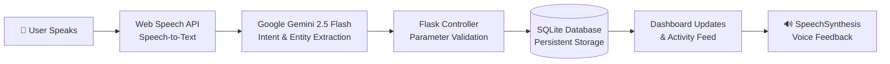
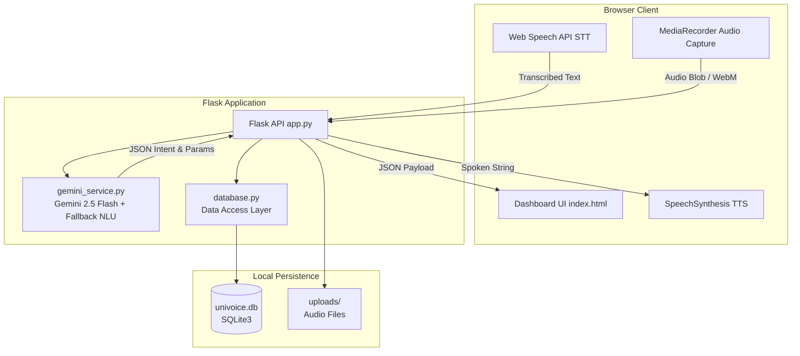

# UniVoice – Smart Voice Action Assistant

[](https://python.org)
[](https://flask.palletsprojects.com/)
[](https://ai.google.dev/)
[](https://sqlite.org)
[](https://developer.mozilla.org/en-US/docs/Web/API/Web_Speech_API)
[](https://opensource.org/licenses/MIT)

> **UniVoice** is an action-oriented Voice AI Assistant built for university students and hackathon teams. It unifies voice budget tracking, to-do reminders, multimodal meeting analysis with email drafting, and strictly grounded campus directories into a single dark-tech dashboard.

---

## ⚡ What is UniVoice?

Unlike generic conversational chatbots that merely generate open-ended text, **UniVoice executes real-world actions**. 

It listens to spoken student requests, uses **Google Gemini 2.5 Flash** to extract structured intents and parameters, validates data, writes directly to a local **SQLite database**, and speaks the response aloud using the browser's native **SpeechSynthesis** engine.



---

## 🚀 Key Modules & Capabilities

### 1. 💰 Voice Expense & Task Tracker
* **Hands-Free Expense Logging:** Say *"Spent 14.50 on lunch at cafeteria"* or *"Add $30 expense for textbooks"*.
* **Automatic Entity Extraction:** Isolates `amount`, `category` (*Food, Travel, Books, Supplies, Tech, Entertainment, Other*), `description`, and `date`.
* **Academic To-Dos:** Say *"Remind me to submit machine learning assignment by Friday 5 PM"*.
* **Live SQLite Sync:** View real-time spending metrics, category breakdowns, and an interactive task checklist with completion checkboxes and delete actions.

### 2. 📝 Meeting Assistant
* **Flexible Ingestion:** Record audio directly in-browser (`MediaRecorder`), drag-and-drop audio files (`.mp3`, `.wav`, `.webm`, `.m4a`), or paste raw meeting notes.
* **Multimodal AI Analysis:** Gemini transcribes the dialogue, generates an executive summary, and extracts actionable items with explicit assignees and deadlines.
* **Follow-up Email Draft:** Automatically composes a formatted follow-up email.
* **One-Click Clipboard Copy:** Click **"Copy Email Draft"** to copy the text to your clipboard with toast notification.
* **Saved History:** SQLite stores all meeting transcripts, summaries, and action items for historical reference.

### 3. 🎓 Campus Assistant (Strict Grounding)
* **Weekly Class Schedules:** Ask *"What classes do I have on Monday?"* or *"When is the Database Systems lecture?"*.
* **Campus Events Registry:** Inquire about upcoming university hackathons, workshops, and career fairs.
* **Central Library Catalog:** Check book availability, author details, and exact shelf/rack locations (e.g. `Rack C1 - Shelf 3`).
* **Zero Hallucination Guarantee:** UniVoice strictly answers from verified local records. If a class or book does not exist (e.g. *"When is Quantum Astrology lecture?"*), it explicitly states that the item was not found rather than inventing an answer.

---

## 🏛️ System Architecture

UniVoice is built as a clean, decoupled application:



---

## 🛠️ Technology Stack

| Layer | Component | Details |
|---|---|---|
| **Backend** | Python 3.11 + Flask 3.1 | Lightweight REST API and voice action router |
| **Database** | SQLite3 | 7 normalized tables, foreign keys, and pre-seeded campus records |
| **AI Brain** | Google Gemini 2.5 Flash | Structured JSON output (`google-genai` SDK) + multimodal audio |
| **Speech-to-Text** | Web Speech API | Client-side real-time speech recognition with interim results |
| **Text-to-Speech** | Browser `SpeechSynthesis` | Zero-latency voice output with mute/unmute control |
| **Audio Capture** | HTML5 `MediaRecorder` | In-browser live meeting recording |
| **Frontend** | Vanilla ES6+ & CSS3 | Dark-tech glassmorphism design system without external build tools |

---

## ⚡ Quickstart Guide

### 1. Prerequisites
- Python 3.10+ installed.
- A modern browser (Google Chrome, Microsoft Edge, Brave, or Safari) for Web Speech API microphone support.

### 2. Install Dependencies
```bash
pip install -r requirements.txt
```

### 3. Configure Environment Variables
Create your local `.env` file from `.env.example`:
```bash
copy .env.example .env
```
Add your Google Gemini API key:
```env
GEMINI_API_KEY=your_gemini_api_key_here
FLASK_PORT=5000
FLASK_DEBUG=True
```
> **Fail-Safe Offline Mode:** If you do not have a Gemini API key immediately, UniVoice automatically falls back to its built-in **Local Rule-Based NLU engine**. Voice recognition, voice synthesis, expense logging, reminders, and campus lookups will all work out-of-the-box!

### 4. Run the Application
```bash
python app.py
```
Open your browser and navigate to:
```
http://127.0.0.1:5000
```
Allow microphone access when prompted by the browser.

---

## 🗣️ Sample Voice Commands for Live Demos

| Category | Voice Command | What UniVoice Executes |
|---|---|---|
| **Expense** | *"Spent 14.50 on lunch at cafeteria"* | Extracts $14.50, Food, Lunch at Cafeteria; saves to SQLite; updates totals. |
| **Expense** | *"How much did I spend today?"* | Calculates daily total and speaks spending breakdown. |
| **Reminder** | *"Remind me to submit AI assignment by Friday 5 PM"* | Saves task with deadline; displays in interactive checklist. |
| **Reminder** | *"What are my pending tasks?"* | Speaks and lists all incomplete to-dos. |
| **Campus** | *"What classes do I have on Monday?"* | Reads Monday's classes (CS301 at 9:00 AM, CS305 at 11:00 AM). |
| **Campus** | *"When is the university hackathon?"* | Details Annual Hackathon 2026 on Nov 14 at the Main Auditorium. |
| **Campus** | *"Is Clean Code available in the library?"* | Reports: *"Available in Rack C1 - Shelf 3 with 1 copy in stock."* |
| **Strict Grounding** | *"When is Quantum Astrology lecture?"* | **Rejects hallucination:** *"I could not find any classes for Quantum Astrology in the campus timetable directory."* |

---

## 🧪 Automated Test Suite

UniVoice includes a comprehensive test suite covering all endpoints, voice intents, SQLite persistence, and strict grounding verification:

```bash
python tests/test_univoice.py
```

### Test Results
```text
Ran 9 tests in 0.22s
OK
[PASS] System status endpoint OK
[PASS] Voice add expense OK
[PASS] Voice add task OK
[PASS] Voice list expenses and tasks OK
[PASS] Campus timetable query OK
[PASS] Campus strict grounding (no hallucinations) OK
[PASS] Campus library query OK
[PASS] Meeting processing, action items extraction, & email draft OK
[PASS] Manual CRUD endpoints OK
```

---

## 📁 Repository Structure

```text
VoiceAI/
│
├── app.py                     # Flask server, API endpoints & command dispatcher
├── database.py                # SQLite schema, CRUD operations & pre-seeded dataset
├── gemini_service.py          # Google Gemini 2.5 Flash SDK & fallback NLU engine
├── requirements.txt           # Python package dependencies
├── .env.example               # Example environment configuration
├── .env                       # Local environment file (API keys)
├── README.md                  # GitHub project README
├── PROJECT_DOCUMENTATION.md   # Comprehensive technical report
├── HACKATHON_SUBMISSION.md    # Concise hackathon judging summary
├── SCREENSHOTS_GUIDE.md       # Guide to capturing project screenshots
│
├── templates/
│   └── index.html             # Single-page dashboard with 3 module views
│
├── static/
│   ├── css/
│   │   └── style.css          # Dark-mode glassmorphism design system
│   └── js/
│       ├── speech.js          # Web Speech API STT and SpeechSynthesis TTS
│       └── app.js             # Client controller, state & meeting recorder
│
├── tests/
│   ├── __init__.py            # Test package marker
│   └── test_univoice.py       # Automated unit test suite
│
└── uploads/                   # Storage directory for meeting audio files
```

---

## 📄 License
This project is open-source and available under the [MIT License](LICENSE).
